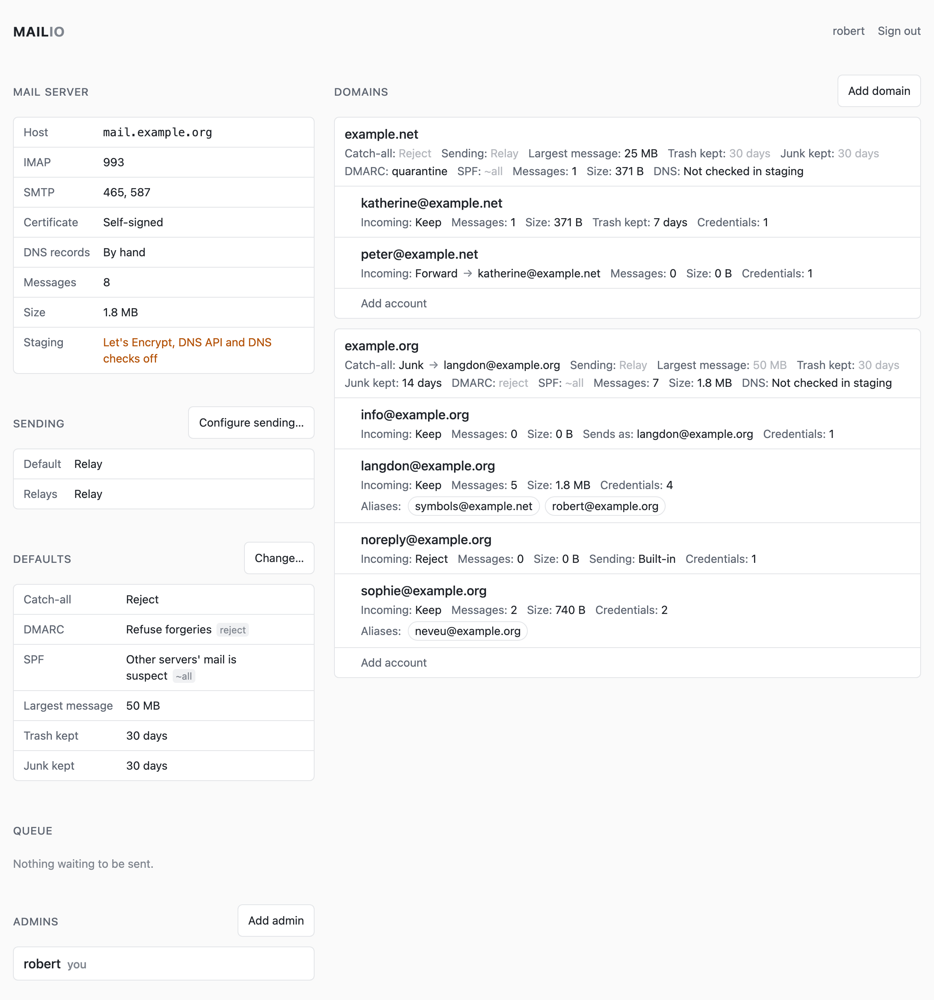
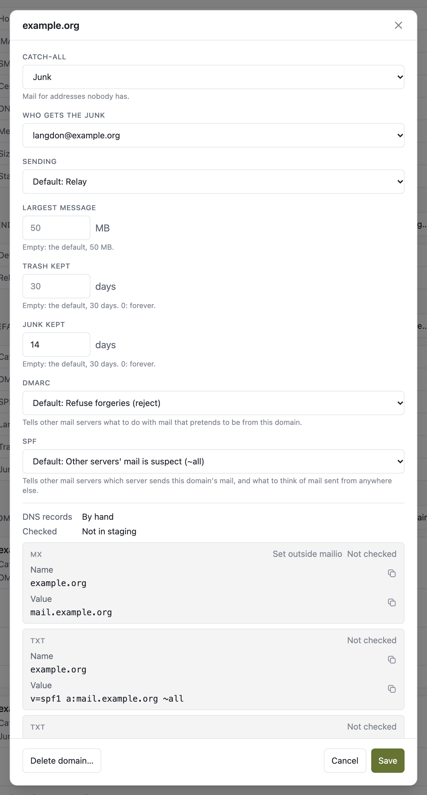
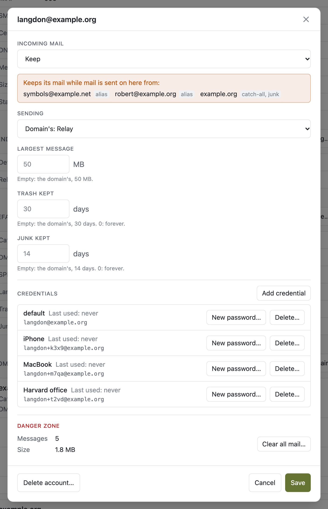
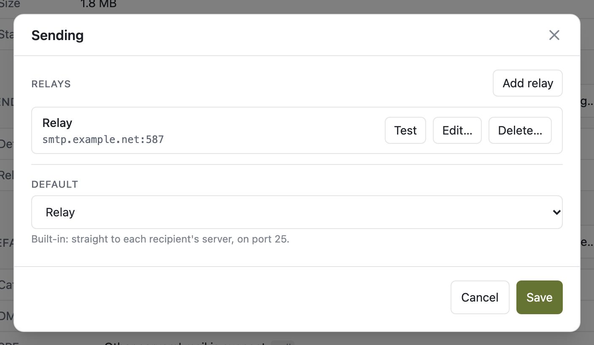

# mailio

A mail server in one static Go binary and one SQLite file. Domains, accounts and their settings
live in the database and are managed in its admin interface; mail is read with
[emguio](https://github.com/reeywhaar/emguio) or any mail client over IMAP.

- **Checks what arrives.** SPF, DKIM and DMARC, which say which servers send a domain's mail and
  prove a message comes from it, are checked on every message: what its sender's domain says to
  refuse is refused, and what it says to quarantine goes to Junk.
- **The standard mailboxes:** Inbox, Sent, Drafts, Archive, Junk and Trash. Trash and Junk empty
  themselves after 30 days, or what a domain or an account says.
- **Signs what it sends** with each domain's DKIM key. Failures are retried for five days and
  reported to the sender.
- **Relays,** such as Gmail, for a host whose provider blocks sending mail out directly: a list,
  one the default, and a domain or an account can choose another, or send directly.
- **Scheduled sending.** A mail client can have a message held and sent later, up to a year on
  (FUTURERELEASE). It waits in the Scheduled mailbox, where deleting it cancels it, and is filed
  in Sent when it goes.
- **Aliases.** Another address of an account, at any domain: its mail arrives in the account,
  which sends as it too.
- **Forwarding.** An account can pass its mail on to another account, or refuse it, as a no-reply
  address that only sends.
- **Sending as another account.** An account keeps its own mail, and what it sends leaves as
  another account: from its address, signed with its domain's key, through its relay.
- **Receive-only accounts.** An account can be set not to send: its logins read its mail, and
  what they try to send is refused.
- **Plus addresses.** `inbox+shop@example.com` arrives in `inbox@example.com`.
- **Catch-all.** Mail for addresses nobody has is refused or dropped, or delivered to an account,
  into its Inbox or its Junk.
- **A password per device.** Each credential has a label, its own login,
  `inbox+k3x9@example.com`, and a password, generated or typed and shown once, and shows when it
  was last used. Delete the phone's without touching the laptop's.
- **Defaults, which a domain can override:** the catch-all, the DMARC and SPF it publishes, the
  relay, the largest message, 50 MB until changed, and how long Trash and Junk keep mail. An
  account can override the relay, the largest message and how long its Trash and Junk keep mail.
- **Automatic TLS.** The mail ports' certificate comes from Let's Encrypt and is renewed before
  it runs out, through a DNS API ([doapi](https://github.com/reeywhaar/doapi)).
- **DNS records.** Through the same DNS API, each domain's DKIM, SPF and DMARC are published.
  With or without one, every record, MX included, is checked against what DNS serves, and what
  is missing or wrong is marked.
- **Messages and their size,** for each account, each domain and the whole server. An account's
  mail can be cleared from its danger zone.
- **Backups** of the whole server, as one file, to a
  [backio](https://github.com/reeywhaar/backio) agent.

## Run it

Behind [caddy-docker-proxy](https://github.com/lucaslorentz/caddy-docker-proxy), which serves the
admin interface over HTTPS; the mail ports are published from mailio itself:

```yaml
# compose.yml
services:
  mailio:
    image: ghcr.io/reeywhaar/mailio:v2
    container_name: mailio
    restart: unless-stopped
    environment:
      MAILIO_PUBLIC_URL: https://mail.example.com
      MAILIO_SECRET_KEY: … # openssl rand -base64 32
    ports: ["25:25", "465:465", "587:587", "993:993"]
    volumes:
      - data:/data
    networks:
      - caddy
    labels:
      caddy: mail.example.com
      caddy.reverse_proxy: "{{upstreams 80}}"

volumes:
  data:

networks:
  caddy:
    external: true
```

```sh
docker compose up -d
docker compose logs mailio
```

The log has a link. Open it and choose the first admin's name and password: a sign-in for the
admin interface, not a mailbox. Then, in the admin interface:

[](docs/screenshots/admin.png)

1. **Add a domain,** and point its MX at the mail host. A click on its row opens its settings,
   and the records mailio keeps for it: SPF, DMARC and its DKIM key.

   [](docs/screenshots/domain.png)

2. **Add an account** under its domain, with the name before the `@`. Each domain's accounts are
   listed under it, each with its aliases. Its first credential is labelled `default`, its login
   is the address itself, and its password is generated and shown once.

   [](docs/screenshots/account.png)

3. **Add a relay** under Sending → Configure sending…, if the host's provider blocks outbound
   port 25, press Test, and make it the default.

   [](docs/screenshots/sending.png)

Invented domains and mail, captured from the real thing by `npm --prefix web run screenshots`;
see [docs/screenshots](docs/screenshots/).

Locked out later:

```sh
docker compose exec mailio mailio admin reset
```

| variable | |
| --- | --- |
| `MAILIO_PUBLIC_URL` | *required.* Where the admin interface is opened |
| `MAILIO_SECRET_KEY` | *required.* Seals the relays' passwords; keep it apart from backups |
| `MAILIO_MAIL_HOST` | the mail server's name, if not the public URL's host |
| `MAILIO_DNS_API_URL` | a DNS API, to publish records and get the certificate |
| `MAILIO_BACKUP_URL` | a backio agent's `POST /backup` |
| `MAILIO_TRUSTED_PROXIES` | whose `X-Forwarded-For` is believed; `private` by default |
| `MAILIO_STAGING` | `true` for a test copy: Let's Encrypt, the DNS API and DNS checks are off |

Each is explained in [docs/deploy.md](docs/deploy.md), with fail2ban, the ports, and moving from
the Postfix-based mailio.

## Set up a mail client

| | |
| --- | --- |
| Incoming | IMAP, `mail.example.com`, port 993, SSL/TLS |
| Outgoing | SMTP, `mail.example.com`, port 465 SSL/TLS, or 587 STARTTLS |
| Username | the credential's login: `inbox@example.com` for the default, `inbox+k3x9@example.com` for another |
| Password | the credential's password |

A password is shown once, when it is made, and only its hash is kept. Give each device its own
credential: when one is lost, delete it and the others keep working, or give it a new password
and the same login.

## Command line

```sh
mailio serve                                   # the server; the image's default
mailio admin reset                             # a new admin link
mailio import maildir <dir> <address>...       # mail from a Maildir, sorted to its recipients
mailio version
```

`import maildir` takes the Postfix-based mailio's Maildirs, `.Sent` and `.Junk` included, and
sorts a Maildir several addresses shared to whoever each message was sent to. `--dry-run` counts
without writing.

## Images

| tag | |
| --- | --- |
| `:v2` | this mailio, fixes included: what a deployment pins to |
| `:latest` | whatever was published last; a pin to nothing |
| `:v1` | the Postfix-based mailio's last image |

## Develop

Go 1.27 and Node 26.

```sh
sh patch-packages.sh                            # dependencies' patches, once after cloning
go test ./...                                   # the server, including SMTP in and IMAP out end to end
npm --prefix web ci && npm --prefix web test    # the admin interface

mkdir -p data
MAILIO_PUBLIC_URL=http://localhost MAILIO_SECRET_KEY=$(openssl rand -base64 32) \
  MAILIO_DATA_DIR=data go run . serve
```

`npm --prefix web run dev` serves the admin interface with reloading and sends `/api` to the
server on port 80. `.github/smoke/smoke.sh` runs a built image through mail in, mail out and a
restart, as CI does before publishing:

```sh
docker build -t mailio:smoke . && IMAGE=mailio:smoke .github/smoke/smoke.sh
```

```
main.go             the command line
internal/
  store/            SQLite: domains, accounts, credentials, mailboxes, messages, the queue
  smtpd/            25 in, with SPF, DKIM and DMARC; 465 and 587 out
  imapd/            993
  outbound/         the queue: the relay or each recipient's MX, retries, bounces
  certs/ dnssync/   the certificate and the DNS records, through the DNS API
  maildir/          the importer
  api/              the admin interface's JSON
  backup/           snapshots to backio
patches/            fixes to dependencies, as diffs: FUTURERELEASE for go-smtp
web/                the admin interface: React, Tailwind; scripts/screenshots, the README's pictures
docs/               decisions: deploy, addresses, storage, API, conventions; the screenshots
```

Where mail to an address goes is decided in [docs/addresses.md](docs/addresses.md), how it is
stored in [docs/storage.md](docs/storage.md), the admin API in [docs/api.md](docs/api.md), and how
the code is written in [docs/conventions.md](docs/conventions.md).
